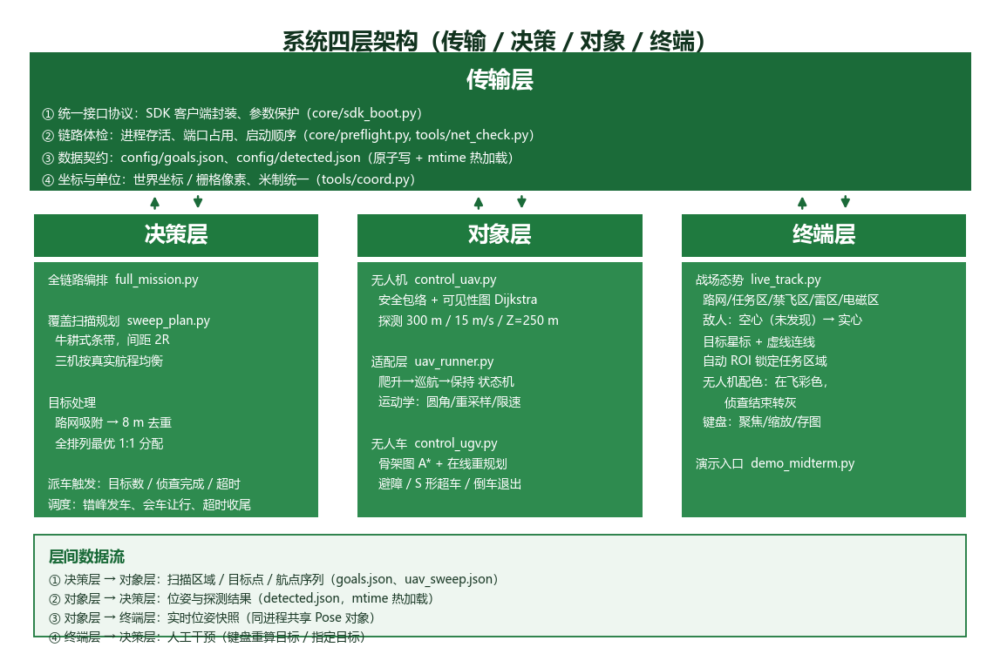

# 智能无人系统技术 —— 多无人机 / 无人车协同仿真

> 课程大作业：CarlaUE4 场景下 **3 架无人机 + 3 台无人车** 的
> 「区域覆盖侦查 → 目标发现 → 分配打击」全链路仿真。



---

## 快速开始

> 依赖课程提供的 CarlaUE4 环境（不在本仓库内），启动顺序见
> [`WorkPlace/docs/演示全流程.md`](WorkPlace/docs/演示全流程.md)。

```powershell
cd WorkPlace

# 1) 清场
python .\tools\kill_all.py

# 2) 手工按顺序启动：CarlaUE4 → start.bat(选2) → subject4.exe
# 3) 体检
python .\tools\kill_all.py --check

# 4) 跑演示
python .\demo_midterm.py
```

演示内容：三架无人机牛耕式覆盖扫描（条带间距 2R）→ 发现敌人 →
按最小总距离 1:1 分配 → 三台无人车 A\* 规划出击 → 小地图实时呈现。

---

## 仓库结构

```
.
├─ README.md                    ← 本文件（项目总览）
├─ .gitignore                   只收"我们写的"，课程环境一律忽略
│
├─ WorkPlace/                   ★ 我们自己的代码与文档
│   ├─ README.md                开发总指南（安装、架构、排错）
│   ├─ demo_midterm.py          一键演示入口
│   ├─ docs/                    ★ 全部文档（从入门到答辩）
│   ├─ missions/                业务层
│   │   ├─ full_mission.py      全链路编排（决策层核心）
│   │   ├─ sweep_plan.py        牛耕式覆盖扫描规划
│   │   ├─ control_uav.py       无人机：安全包络 + 可见性图 + 探测
│   │   ├─ uav_runner.py        无人机驱动适配（运动学 / 虚拟）
│   │   ├─ control_ugv.py       无人车：A* + 避障 + 超车
│   │   └─ live_track.py        战场态势小地图
│   ├─ core/                    通用基础设施（SDK 封装、场景解析、位姿）
│   ├─ tools/                   工具（撒点、清场、诊断、画架构图）
│   ├─ config/                  数据契约（goals/detected/uav_sweep json）
│   ├─ figs/                    成果图（架构图、示意图、截图）
│   └─ selftest/                离线自测（假 SDK，无需仿真器）
│
├─ Partner/                     组员交付的原始代码（存档，便于追溯）
│
└─ Materials/practice/          课程场景（只保留 json 与小图）
```

---

## 四层架构一览

| 层 | 职责 | 主要落点 |
|---|---|---|
| **传输层** | 接口协议、链路体检、数据契约、坐标换算 | `core/sdk_boot.py`、`core/preflight.py`、`config/*.json` |
| **决策层** | 覆盖扫描规划、目标分配、协同调度 | `missions/sweep_plan.py`、`missions/full_mission.py` |
| **对象层** | 无人机 / 无人车各自的控制回路 | `missions/control_uav.py`、`control_ugv.py`、`uav_runner.py` |
| **终端层** | 战场态势与对象信息汇总展示 | `missions/live_track.py` |

详见 [`WorkPlace/docs/四层架构说明.md`](WorkPlace/docs/四层架构说明.md)。

---

## 当前状态

| 项 | 状态 |
|---|---|
| 覆盖扫描（牛耕式，间距 2R，三机分区） | 已实现 |
| 目标发现与 1:1 最优分配 | 已实现 |
| 无人车 A\* 规划 / 避障 / 超车 | 已实现（组员交付） |
| 战场态势小地图 | 已实现（含搜索区高亮、自动 ROI） |
| 无人机 3D 飞行动力学 | **受交付 SDK 限制**，当前用运动学模型驱动 |

> 飞控通道不可用（`control_kinetic_*` 零位移、`launch_kinetic` 全返 `None`），
> 详细证据见 `WorkPlace/docs/中期答辩_技术说明.md` 第 5 节。

---

## 文档

入口：[`WorkPlace/docs/`](WorkPlace/docs/) —— 建议从
[演示全流程](WorkPlace/docs/演示全流程.md) 开始。
