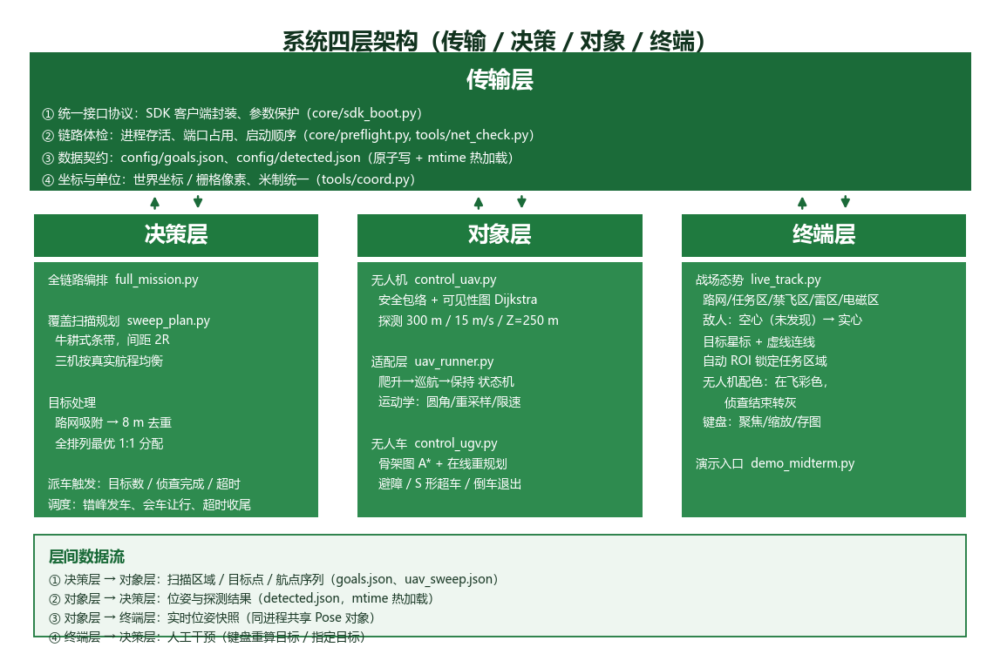

# 系统四层架构说明

> 按课程要求的 **传输层 / 决策层 / 对象层 / 终端层** 组织现有工作。
> 图：`figs/four_layer_arch.png`（`python WorkPlace\tools\draw_arch.py` 可重新生成）



---

## 一、传输层 —— 接口协议与信息对接

> 职责：通过接口协议把各层对接起来，确保信息传输无误。

| 关注点 | 落地实现 | 说明 |
|---|---|---|
| **SDK 接口封装** | `core/sdk_boot.py` | `make_client()` 在构造客户端时临时收走 `sys.argv`，规避 SDK 自身 argparse 抢参数的问题 |
| **链路体检** | `core/preflight.py`、`tools/net_check.py`、`tools/kill_all.py` | 进程存活、端口占用（2000/3301/3302/4443/4444）、启动顺序；多实例检测 |
| **数据契约（文件）** | `config/goals.json`、`config/detected.json`、`config/uav_sweep.json` | 跨模块的轻量接口；原子写（临时文件 + `os.replace`），读取端按 mtime 热加载 |
| **坐标与单位** | `tools/coord.py` | 世界坐标 ↔ 栅格像素（1 px = 1 m，`scale`、`world_offset` 统一管理） |
| **同进程数据交换** | `core/fleet.py` 的 `Pose` | 决策层/终端层共享同一份位姿快照，避免再来一次 RPC |

**接口契约（detected.json）**

```json
{
  "points":     [[x, y], ...],   // 新发现的敌人坐标（米）
  "discovered": [[x, y], ...],   // 累积已发现
  "extra":      [[x, y], ...],   // 附加标记
  "__清空__":   false            // 置 true 时清空
}
```

**接口契约（goals.json）**

```json
{ "UAV1": [x, y], "UGV1": [x, y], "__说明__": "...", "__清空__": false }
```

> 设计要点：**文件是唯一跨进程契约**，字段只增不减；`__清空__` 是唯一的破坏性操作，
> 必须显式设置，避免误清队友数据。

---

## 二、决策层 —— 分析战局、分发任务

> 职责：根据得到的信息分析战局，把任务分发给不同对象。

| 决策点 | 实现 | 算法/规则 |
|---|---|---|
| **覆盖扫描规划** | `missions/sweep_plan.py` | 牛耕式条带，间距 = **2R**；按真实航程把扫描线均衡分给三机（连续切分 + LPT 择优）；禁飞区处"切段不绕行" |
| **全链路编排** | `missions/full_mission.py` | 阶段解锁 → 起飞 → 扫描 → 发现 → 派车 → 收尾，单进程单客户端 |
| **目标可行性处理** | `snap_to_road()` | 敌人常在楼里/路障后，先把坐标吸附到最近路网像素（搜索 40 px） |
| **目标去重** | `dedupe`（8 m） | 无人机重复上报同一点只保留一个 |
| **任务分配** | `assign_targets()` | **全排列暴力枚举**求"三车总行驶距离最短"的 1:1 匹配；目标多于车只取最优 3 个 |
| **派车触发** | 三选一 | ① 目标数 ≥ `--min-targets`；② 无人机全部飞完/损毁；③ 侦查超时（可配兜底目标） |
| **协同调度** | 四条规则 | 错峰发车（4~6 s）、会车让行（14 m 内让"离目标更远"者停 3 s）、起步转向目标、`--ugv-deadline` 超时收尾 |

**为什么决策层值得单独说**

侦查阶段敌人位置未知，所以任务分发不是"把已知目标丢给车"，而是分两步：

1. **先决定"去哪看"** —— 覆盖扫描规划（保证不漏检，且三机负载均衡）
2. **再决定"谁去打"** —— 目标吸附/去重/最优分配（保证车开得到、跑得短）

---

## 三、对象层 —— 无人机 / 无人车及其控制逻辑

> 职责：无人机、无人车作为具体对象，各自包含自己的控制逻辑。

### 3.1 组成：两个文件、两种职责

无人机这一层拆成**"算法本体"**和**"驱动适配"**两块，边界很清楚：

| 文件 | 职责 | 来源 |
|---|---|---|
| `missions/control_uav.py` | 安全包络、航路规划、飞行剖面、探测判定、结果发布 | 组员交付 |
| `missions/uav_runner.py` | 把阻塞循环改造为可单步驱动；飞控不可用时的运动学/虚拟驱动 | 我们补的 |

> 为什么要拆：组员的 `run_controller()` 是 `while True` 阻塞循环，一旦调用就独占进程，
> 无法与无人车、小地图共存。适配层只搬运"循环体"，**不改它的控制逻辑与阈值**。

### 3.2 算法本体 `control_uav.py`

| 模块 | 实现要点 |
|---|---|
| **安全包络** | 任务区内缩 `ARENA_MARGIN=10 m`；3 个禁飞区外扩 `SAFETY_MARGIN=30 m` 成矩形（矩形外扩一定包含真实 30 m 偏置，含凹角——保守但可审计） |
| **航路规划** | 可见性图：起点 + 终点 + 各禁飞区矩形 8 角点；两两做"线段是否穿矩形"判定，Dijkstra 求最短路。**无安全路径即报错，不允许直飞兜底** |
| **飞行剖面** | 高度 `ALTITUDE=250 m`、巡航 `CRUISE_SPEED=15 m/s`；起飞判定要求高度稳定在 `ALTITUDE_TOL=2 m` 内连续 5 帧 |
| **探测** | 每 `DETECT_EVERY=10` 帧一次；判定三条：`Type ∈ {strike, enemy, hostile}`、`HealthPoint > 0`、与机的**水平**距离 ≤ `DETECT_RADIUS=300 m`；`CLUSTER_RADIUS=15 m` 内合并 |
| **发布** | 结果写入 `config/detected.json`（原子写），供决策层与终端层 mtime 热加载 |

### 3.3 驱动层：三种模式

飞控动力学接口在本课程包里不可用（证据见 3.7 与 `中期答辩_技术说明.md` 第 5 节），因此驱动层提供三种模式，
**上层逻辑完全一致**，只换"位姿从哪来"：

| 模式 | 位姿来源 | 是否驱动真实 actor | 适用 |
|---|---|---|---|
| `kinetic` | SDK 飞控指令 `control_kinetic_simply_global` | 是 | 飞控可用时（当前不可用） |
| `kinematic` | 自研运动学模型 → 每帧 `set_transform` | 是 | 需要画面里看到飞机 |
| `virtual` | 纯数学插值，**不触碰 actor** | 否 | 当前演示默认（稳定、零崩溃） |

`virtual` 模式下，探测也改由模型自己算（目标是否落在 300 m 内），
**语义与真机一致**，只是不经过 `detect_situation()`。

**航线来源**：三种模式都只负责"跟踪"，航点由**决策层**给（牛耕覆盖扫描
`sweep_plan.py` 或按已知敌人生成的航线），对象层不自己决定去哪。

### 3.4 运动学模型（`kinematic` / `virtual` 共用）

| 参数 | 值 | 为什么这么定 |
|---|---|---|
| 转角圆角 | 二次贝塞尔，半径 `30 m` | 航线是直线折线，直接走会瞬间掉头；圆角半径与安全余量同量级，不会切进禁飞区 |
| 重采样间距 | `1.5 m` | 等弧长采样，保证任意位置切向连续、速度不忽快忽慢 |
| 偏航限速 | `70 °/s` | 角差归一到 ±180°，避免 ±180° 处来回翻转 |
| 爬升速度 | `12 m/s` | **爬到位才前进**；实测一帧内瞬移 240 m 会撞出致命伤害直接坠毁 |
| 单帧位移上限 | `6 m` | 杜绝任何形式的瞬移（帧率抖动时最多 6 m，不会"蹦"） |
| 时钟 | 墙上时钟 + 单帧 dt 上限 `0.15 s` | 帧率变化时速度不变；卡顿时宁可慢一点也不瞬移 |
| 循环节拍 | `20 ms`（50 Hz） | 位姿更新频率越高画面越顺 |

数值自检（假时钟 700 帧）：单帧位移恒为 `0.750 m`（= 15 m/s × 0.05 s）、
单帧转角 `0.282°`（限速 3.5°）；帧率乱跳时钳制在 2.25 m / 2.14°。

### 3.5 状态机与异常处理

```
climb ──(高度到达 250 m)──▶ cruise ──(航线走完)──▶ hold
   │                          │
   └──── 读不到位姿 20 帧 ────┴──▶ dead（损毁，停止驱动）
```

| 异常 | 判据 | 处理 |
|---|---|---|
| **损毁** | 连续 20 帧 `position()` 抛异常（血量归零后 actor 失效） | 标记 `dead`，停止驱动，写 `UAV LOST` 日志；其余机继续 |
| **高度漂移** | 实测高度与设定值相差 > 5 m | 只报一次 `ALT DRIFT`，提示"还有外力在改位姿" |
| **速度累积** | 每帧 `set_target_velocity(0,0,0)` | 防止重力累积把飞机甩到地面（`set_simulate_physics` 会崩 UE4，不能用） |

### 3.6 层内对外接口

| 接口 | 作用 | 调用方 |
|---|---|---|
| `start()` / `step()` / `stop()` | 单步驱动，可与非阻塞主循环共存 | 决策层 |
| `enemies()` | 当前已发现目标 | 决策层（判断是否派车） |
| `phases_snapshot()` | 每架的相位（climb/cruise/hold/dead） | 终端层（配色）、决策层（是否侦查完） |
| `virtual_pose(name)` | 虚拟位姿 (x, y, z, yaw) | 终端层（虚拟模式下画图标与航迹） |
| `last_goals` | 当前要飞的航点 | 终端层（目标星标与虚线） |
| `all_searching()` / `all_takeoff()` | 是否全部扫完 / 是否全部还在爬升 | 决策层（派车与超时判定） |
| `speed` / `dead` | 巡航速度、已损毁的机名集合 | 终端层（配色）、决策层（兜底派车） |

> 一句话：对象层**不决定去哪**，只负责"按给定航点稳定地飞、按规则探测、把结果交出去"。

### 3.7 当前限制与后续

* **飞控通道不可用**：`control_kinetic_*` 返回 200 但零位移，`launch_kinetic` 18 组参数
  全返回 `None`，`get_kinetic_data()` 恒为 `None`；M10 的物理也关不掉
  （`set_simulate_physics` 触发 UE4 断言崩溃），实测 9.8 m/s² 自由落体
* 因此中期演示用 `virtual` 模式：**算法链路真实，3D 画面中的飞机不动**
* 组员新交付的 SDK 正在对接；恢复后把 `--uav-mode` 从 `virtual` 改回 `kinetic` 即可，
  `UavRunner` 那条真实飞行路径一直保留
* 诊断工具：`python WorkPlace\tools\uav_diag.py takeoff`（30 秒判定飞控是否可用）


### 3.8 无人车 `missions/control_ugv.py`（组员交付）

| 模块 | 内容 |
|---|---|
| 双图 | 1 px 骨架图（A\* 用）+ 真实路宽图（判断能否会车/超车） |
| 路径规划 | 8 邻域 A\*，支持在线重规划（封格子半径 10 px） |
| 路径跟随 | 前视点跟踪；`ARRIVE_DIST = 20 m` 判到达 |
| 避障 | 前方路障触发绕行；绕不过则倒车退出路口（多倒 12 m） |
| 拥堵 | 前方队友停死 3 s → S 形超车（横向最大 5 m） |
| 异常 | 速度 < 0.3 m/s 持续 8 s → `stuck` 上报 |

### 3.9 对象状态一览

| 对象 | 状态机 |
|---|---|
| 无人机 | `climb`（爬升）→ `cruise`（沿扫描线）→ `hold`（飞完）/ `dead`（损毁） |
| 无人车 | `drive` → `reverse`（倒车退出）→ `drive` → `overtake`（超车）→ `arrived` / `stuck` |

---

## 四、终端层 —— 战局与对象信息汇总展示

> 职责：把最终的战局信息与对象信息汇总展示，便于了解全局。

实现：`missions/live_track.py`（纯显示层，**不控制任何载具**）

| 展示要素 | 内容 |
|---|---|
| **环境态势** | 路网底图、任务区、3 个禁飞区、雷区、电磁区、6 组阶段线 |
| **敌情** | 未发现＝空心圈；已发现＝实心红点；配目标星标与虚线连线 |
| **我方对象** | 无人机＝三角形（每架一色），无人车＝方形；带朝向箭头与速度标注 |
| **无人机配色** | 爬升/巡航＝彩色；航线飞完或损毁＝灰色（航迹同步变灰） |
| **刷新节流** | 按**时间间隔**刷新（默认 1.5 s），不随主循环帧率抖动；`--view-interval` 可调 |
| **内存控制** | 路网整图 69 MB 降采样后**立即释放**，常驻只剩约 4 MB；航迹缓冲上限 1000 点 |
| **自动 ROI** | 取"无人机出生点＋无人车出生点＋近处敌人"包围盒，加余量、设上下限并钳制在地图内 |
| **信息面板** | 每台的剩余距离、目标来源（指定/默认）、状态；时间与发现计数 |
| **交互** | `1-6` 聚焦、`0` 总览、`+/-` 缩放、`s` 存图、`r` 重算默认目标 |
| **演示入口** | `demo_midterm.py`：一键运行、进度提示、失败即停 |

---

## 五、层间数据流（答辩时按这个顺序讲）

```
① 决策层 → 对象层：扫描区域 / 目标点 / 航点序列
                   （config/uav_sweep.json、config/goals.json）
② 对象层 → 决策层：位姿与探测结果
                   （config/detected.json，mtime 热加载）
③ 对象层 → 终端层：实时位姿快照（同进程共享 Pose 对象）
④ 终端层 → 决策层：人工干预（键盘重算目标 / 指定目标）
```

---

## 六、与"课程要求"的对应关系

| 课程分层 | 我们的落点 | 完成度 |
|---|---|---|
| 传输层 | SDK 封装、链路体检、JSON 契约、坐标换算 | 已完成 |
| 决策层 | 覆盖扫描规划、目标分配、协同调度 | 已完成 |
| 对象层 | 无人机（规划/探测）、无人车（A\*/避障/超车） | 控制逻辑完成；**无人机飞行动力学受交付 SDK 限制，暂用运动学模型** |
| 终端层 | 战场态势小地图、配色与交互 | 已完成 |

---

## 七、一句话总结每层

* **传输层**：把"谁跟谁说话、说什么格式"钉死，出错能第一时间定位。
* **决策层**：敌人未知时先规划"怎么找"，找到后再算"谁去打、怎么去"。
* **对象层**：无人机管"看得见"，无人车管"到得了"，各自有独立控制回路。
* **终端层**：把四层的结果汇到一张图上，让人一眼看懂战局。
